[](https://nextjs.org)
[](https://react.dev)
[](https://www.typescriptlang.org)
[](https://www.postgresql.org)
[](https://www.prisma.io)
[](LICENSE)

# SportComplex — Sistema de reservas de canchas por turnos

Aplicación web multisede para consultar disponibilidad y solicitar reservas deportivas. Incluye gestión de canchas, tarifas, bloqueos, comprobantes, notificaciones e informes; la interfaz puede conservar operaciones pendientes en el navegador y sincronizarlas con el servidor.

SportComplex es un proyecto de portfolio con datos de demostración. La documentación describe código y configuración del repositorio; no acredita un despliegue ni la disponibilidad actual de proveedores externos.

## Funcionalidades

- Consulta de sedes, canchas, tarifas y disponibilidad.
- Solicitudes, historial y acciones administrativas sobre reservas.
- Gestión de sede, canchas, tarifas, bloqueos y usuarios según permisos.
- Cola offline con identificadores de operación, reintentos, conflictos y actualización desde el servidor.
- Indicadores, reportes y exportación PDF/CSV.
- Flujos de recuperación de cuenta y almacenamiento de comprobantes mediante adaptadores configurables.

Las reglas de sincronización están descritas en [docs/SYNC_INVARIANTES.md](docs/SYNC_INVARIANTES.md). La vista del sistema está en [docs/architecture/00-overview.md](docs/architecture/00-overview.md).

## Tecnología y estructura

Next.js App Router, React, TypeScript, PostgreSQL, Prisma, IndexedDB/Dexie, Vitest y Playwright.

| Ruta | Contenido |
|---|---|
| `src/app/` | Páginas, layouts y rutas API |
| `src/components/` | Componentes de interfaz por área funcional |
| `src/lib/domain/` | Casos de uso y reglas de negocio |
| `src/lib/auth/`, `src/lib/offline/`, `src/lib/sync/` | Autenticación, almacenamiento local y sincronización |
| `prisma/` | Esquema y migraciones de persistencia |
| `tests/unit/` | Conjunto unitario aislado |
| `tests/integration/` | Pruebas de integración |
| `tests/e2e/` | Flujos de navegador con Playwright |
| `tools/scripts/` | Utilidades de desarrollo, diagnóstico y captura |
| `docs/architecture/`, `docs/decisions/` | Arquitectura y decisiones técnicas |
| `docs/images/` | Imágenes de este documento |

## Inicio local

Requisitos: Node.js según `engines` en `package.json`, dependencias npm y PostgreSQL aislado para las funciones que usan persistencia.

```bash
npm ci
cp .env.example .env
# Configura los valores necesarios en tu entorno local.
npx prisma migrate deploy
npm run dev
```

La inicialización de cuentas requiere una base preparada para desarrollo. Revisa el uso de la utilidad antes de ejecutarla:

```bash
node tools/scripts/crear-superadmin.mjs
```

No ejecutes migraciones o utilidades que escriban datos contra una base compartida o de producción.

## Comandos del proyecto

| Comando | Uso |
|---|---|
| `npm run dev` | Servidor de desarrollo |
| `npm run typecheck` | Comprobación estática de TypeScript |
| `npm run lint` | ESLint |
| `npm run test:unit` | Conjunto aislado definido por `vitest.unit.config.ts` |
| `npm run test:integration` | Pruebas de `tests/integration/`; revisa previamente sus dependencias de persistencia |
| `npm run test:e2e` | Playwright en Chromium; inicia build y servidor local según `playwright.config.ts` |
| `npm run build` | Build de producción; requiere configuración compatible con el código y sus dependencias |

El workflow de CI en `.github/workflows/ci.yml` ejecuta instalación, `typecheck`, `lint` y `test:unit` (33 archivos, 119 pruebas aisladas sin dependencia de base de datos). Esto describe el workflow configurado y la suite unitaria actual, no el funcionamiento de proveedores externos ni de un despliegue.

Las pruebas de integración y E2E pueden operar sobre estado persistente y no se deben dirigir a datos reales. El conjunto unitario tampoco certifica el funcionamiento de proveedores externos o de un despliegue.

## Utilidades

Los scripts están bajo `tools/scripts/`. Ejemplos de rutas actuales:

```bash
node tools/scripts/diagnostico-pool.mjs
node tools/scripts/probar-correo.mjs
node tools/scripts/verificar-storage.mjs
```

Algunos scripts requieren configuración de servicios o pueden realizar escrituras. Consulta su código y confirma que el entorno sea aislado antes de usarlos.

## Imágenes

### Reserva y seguimiento

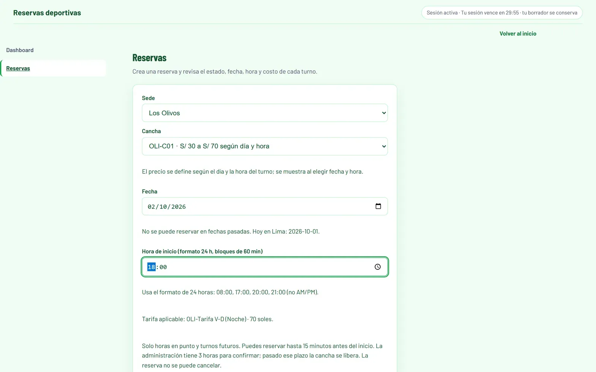
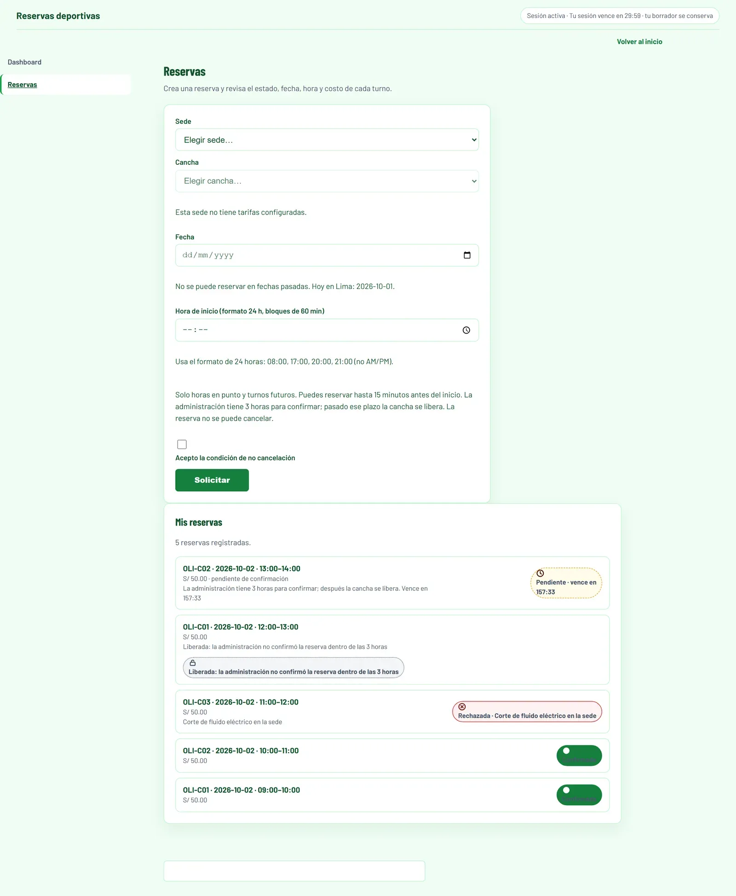

### Operación y reportes

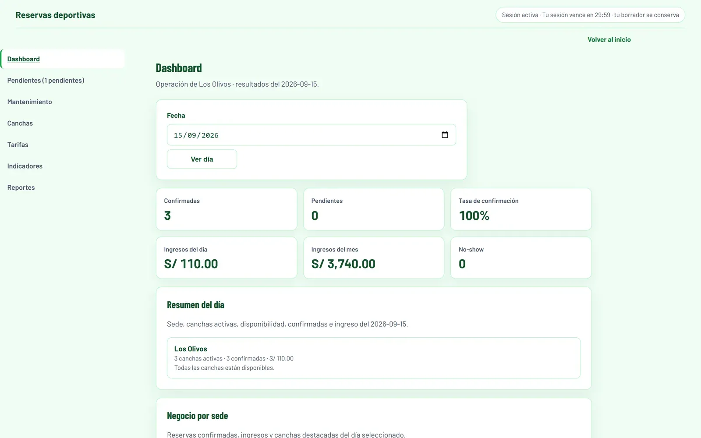
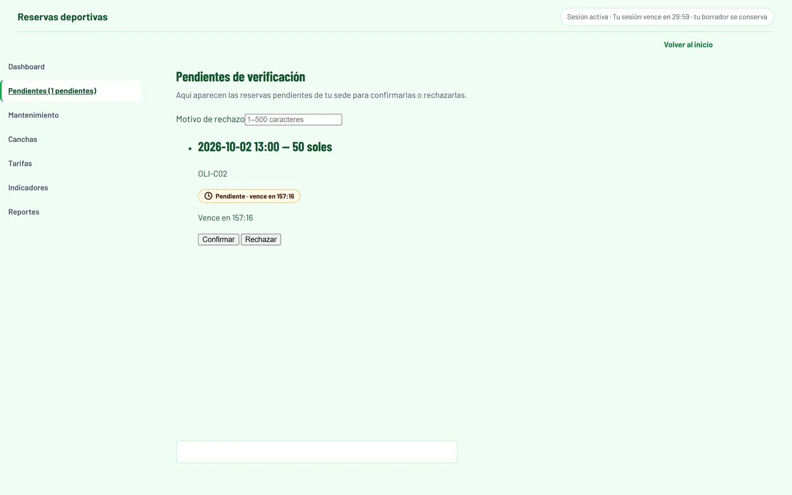
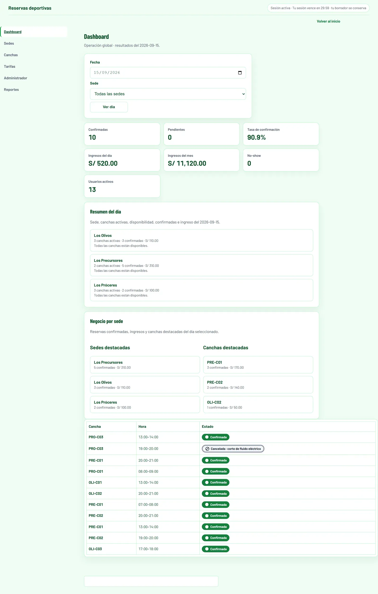
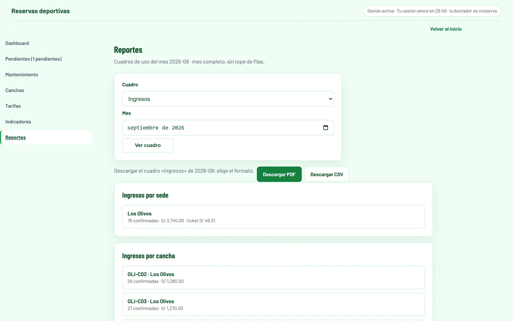

<details>
<summary>Otras vistas</summary>


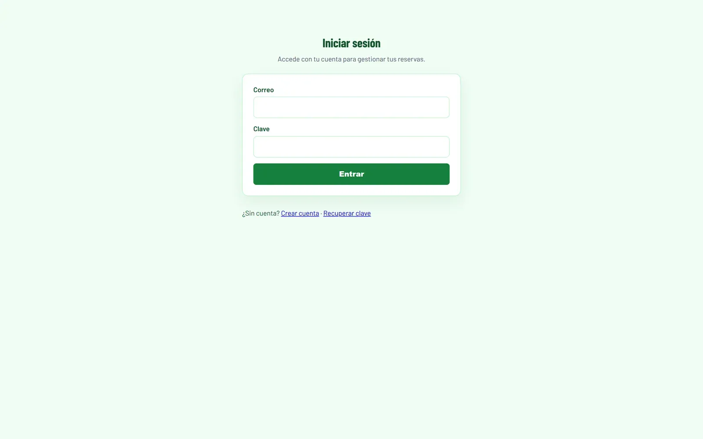
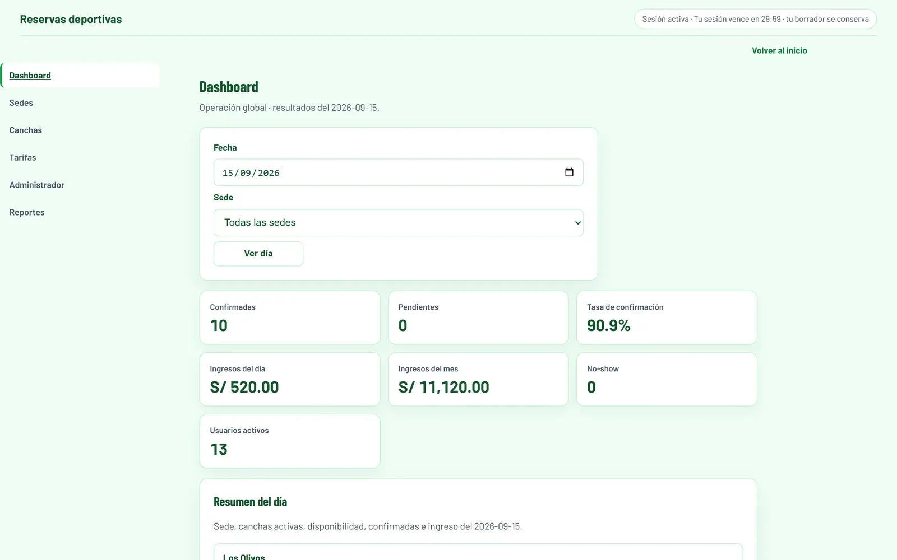
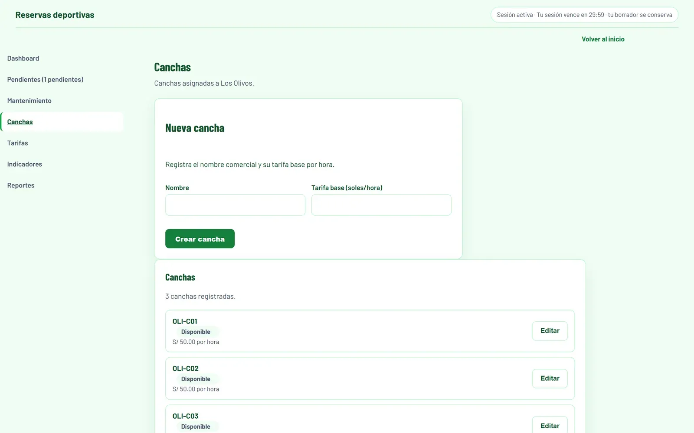
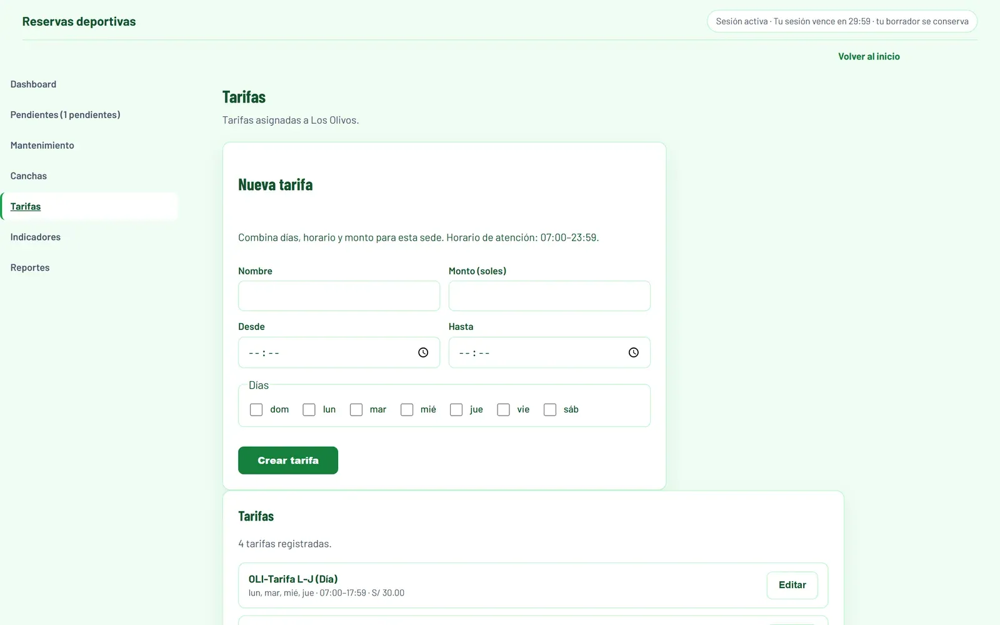
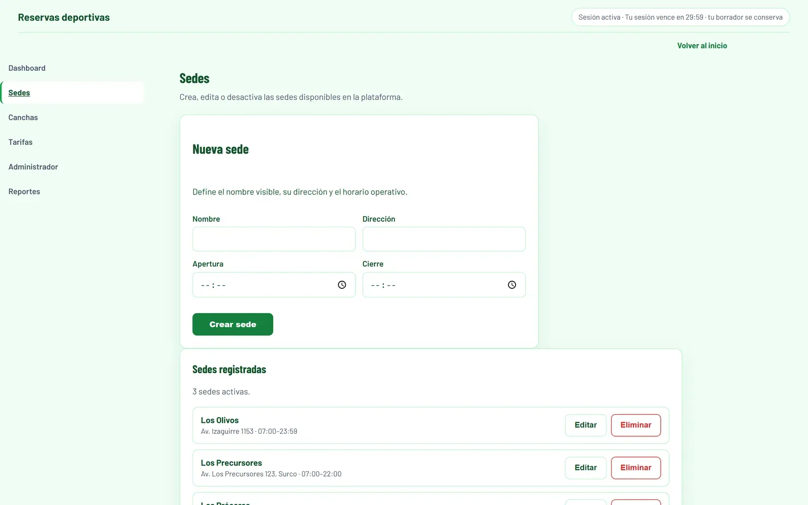
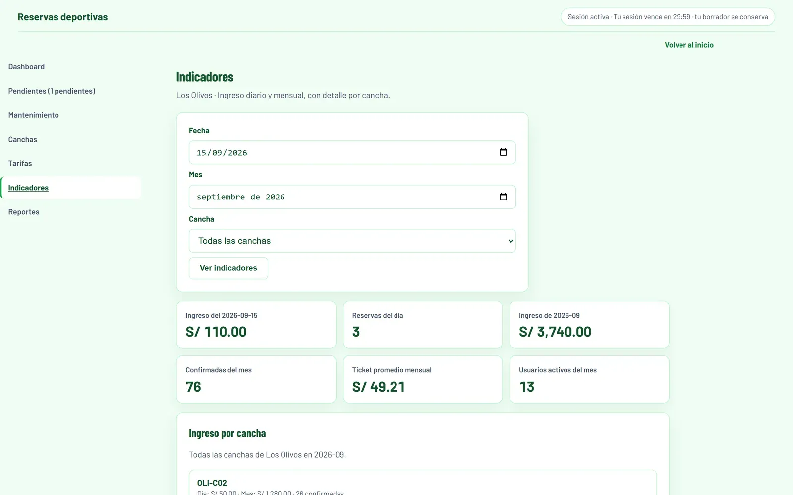
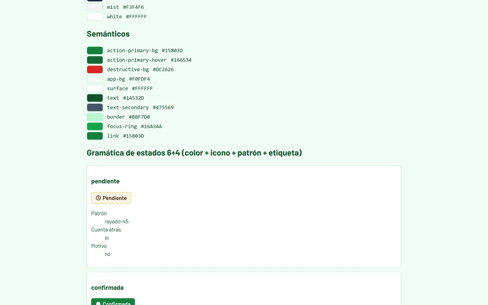
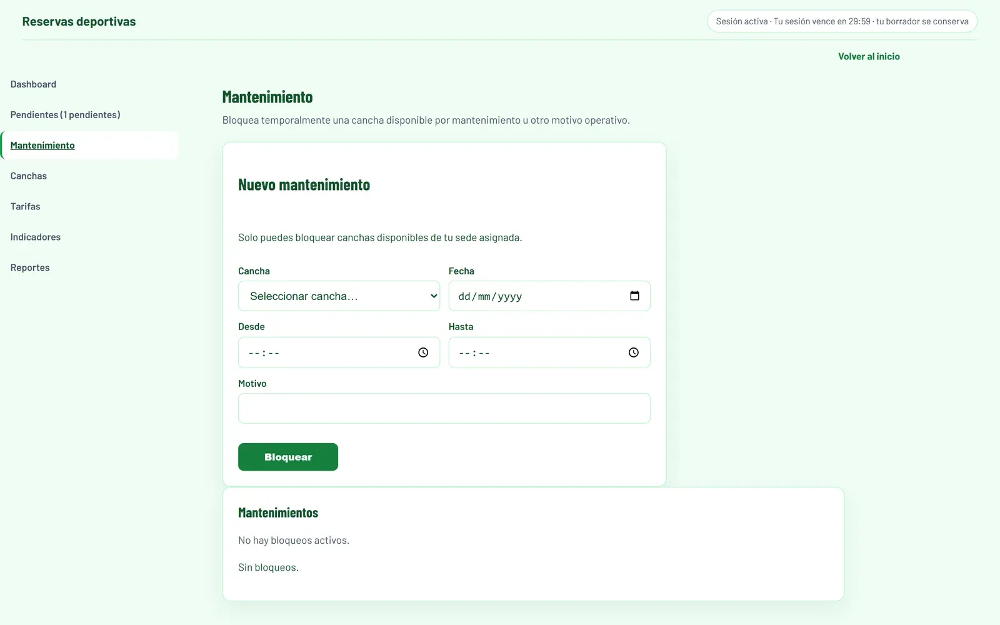
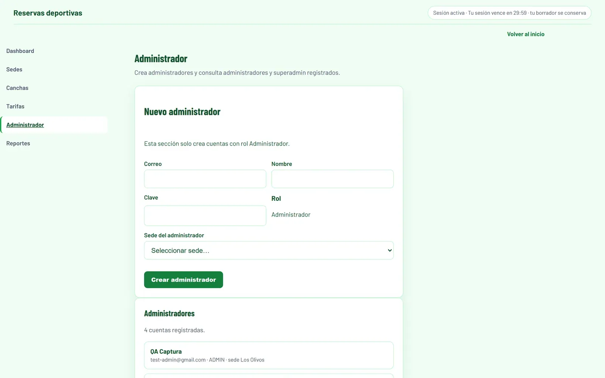

</details>

## Documentación

- [Arquitectura](docs/architecture/00-overview.md)
- [Índice de decisiones](docs/decisions/index.md)
- [Contrato de sincronización](docs/SYNC_INVARIANTES.md)

## Licencia

Licencia MIT; consulta [LICENSE](LICENSE).
