[](https://nextjs.org)
[](https://react.dev)
[](https://www.typescriptlang.org)
[](https://www.postgresql.org)
[](https://www.prisma.io)
[](LICENSE)

# SportComplex — Sistema de reservas de canchas por turnos

Aplicación web multisede para reservar canchas deportivas en bloques de 60 minutos, con tres roles diferenciados, tarificación por día y franja horaria, y validación de reglas en el servidor.

Las reglas críticas (disponibilidad, horarios, precios y expiración de reservas) se aplican en la base de datos y en la API, no solo en la interfaz. Si una reserva no es confirmada por administración dentro del plazo, se libera automáticamente y el estado queda visible para el usuario.

## Objetivo del proyecto

SportComplex es un **proyecto de portfolio** que utiliza la gestión de reservas deportivas como caso práctico para mostrar el desarrollo de una aplicación web completa: interfaz, API, persistencia, control de acceso e integración con servicios externos. No es un servicio comercial ni se encuentra en uso operativo; los datos de demostración son ficticios.

El proyecto permite explorar las siguientes competencias a través de una implementación concreta:

| Competencia | Aplicación en SportComplex |
|---|---|
| Desarrollo full stack con TypeScript | Interfaz con React y Next.js App Router, junto con endpoints HTTP para reservas, administración y reportes |
| Diseño y consumo de API | La interfaz consume rutas que validan entradas, identidad, permisos y reglas de negocio, con respuestas HTTP diferenciadas |
| Modelado relacional y transacciones | PostgreSQL y Prisma para relacionar sedes, canchas, usuarios y solicitudes; restricciones y bloqueos para controlar reservas concurrentes |
| Autenticación y autorización | Sesiones JWT en cookies httpOnly, permisos por rol y validaciones de pertenencia a una sede en la API |
| Persistencia local y sincronización | IndexedDB con Dexie, cola de operaciones y protocolo de sincronización para gestionar conectividad intermitente |
| Integración de servicios | Adaptador de Supabase Storage para comprobantes y envío SMTP para recuperación de contraseña |
| Procesamiento y presentación de datos | Indicadores, filtros y reportes con exportación a PDF y CSV |
| Pruebas y automatización | Suites con Vitest y Playwright, análisis estático y definición de un flujo de integración continua en GitHub Actions |

Estas capacidades describen el alcance implementado. El estado de las verificaciones y sus límites se detalla en [Calidad y pruebas](#calidad-y-pruebas).

---

## Características principales

**Reserva para usuarios finales**

- Búsqueda por sede, cancha, fecha y hora, con precio calculado antes de confirmar.
- Historial de reservas con estado y cuenta atrás del plazo de confirmación.
- Subida de comprobantes de pago y centro de notificaciones.
- Funciona con conectividad intermitente: las operaciones se encolan localmente y se sincronizan al recuperar conexión, sin duplicados.

**Operación por sede (rol Administrador)**

- Tablero diario de la sede con ingresos y ocupación, calculados desde la base de datos.
- Gestión de reservas pendientes (confirmar / rechazar con motivo).
- Gestión de canchas, tarifas por día y franja, bloqueos por mantenimiento y reportes del mes.
- Alcance limitado a su sede en cada operación, verificado en la API.

**Gestión global (rol Superadmin)**

- Vista consolidada de todas las sedes, tablero global y grilla diaria.
- Administración de sedes, canchas, tarifas y cuentas de administrador.

**Reportes del mes**

- Cuatro informes: ingresos, ocupación, estados y clientes.
- Exportación a PDF (con portada, paginación y totales) y CSV.
- Consulta directa con filtro por mes, sin límite de filas que distorsione los totales.

---

## Reglas de negocio en el servidor

| Regla | Implementación | Efecto |
|---|---|---|
| Un turno por cancha y franja | Índice único parcial en PostgreSQL + bloqueo `SELECT … FOR UPDATE` | Dos peticiones concurrentes al mismo turno devuelven una `201` y una `409` |
| El turno debe estar dentro del horario de la sede | Validación `validarTurnoEnSede` | Rechaza reservas fuera del horario de atención |
| Bloques de 60 minutos, en hora en punto y a futuro | Validación `validarReserva` | Rechaza turnos como 20:20 o en el pasado |
| Anticipación mínima de 15 minutos | Validación `validarReserva` | Rechaza turnos que ya comenzaron o están por comenzar |
| Precio según tarifa vigente del día y la hora | Cálculo `calcularMontoCentavos` en el servidor | El importe cobrado coincide con el mostrado en el formulario |
| Plazo de confirmación de 3 horas | Expiración `limiteHold` + job programado y verificación oportunista | Las reservas no confirmadas pasan a `LIBERADA` y la cancha vuelve a estar disponible |

Las suites del proyecto incluyen casos sobre estas reglas. Su validación integrada depende de disponer del entorno de pruebas correspondiente.

---

## Stack tecnológico

| Capa | Tecnología |
|---|---|
| Frontend / Backend | Next.js 16, React 19, TypeScript 5.9 (App Router + 31 rutas API) |
| Datos | PostgreSQL 15, Prisma 7 (13 tablas, 12 migraciones, RLS forzado) |
| Autenticación | Sesiones con JWT httpOnly, matriz de roles `USUARIO` / `ADMIN` / `SUPERADMIN` |
| Offline-first | IndexedDB (Dexie), cola de operaciones idempotente, sincronización con el servidor como árbitro |
| Archivos | Supabase Storage (comprobantes de pago) |
| Correo | SMTP (recuperación de contraseña y notificaciones) |
| Calidad | Vitest, Playwright, ESLint, `tsc --noEmit` |

---

## Capturas

### Reserva y seguimiento

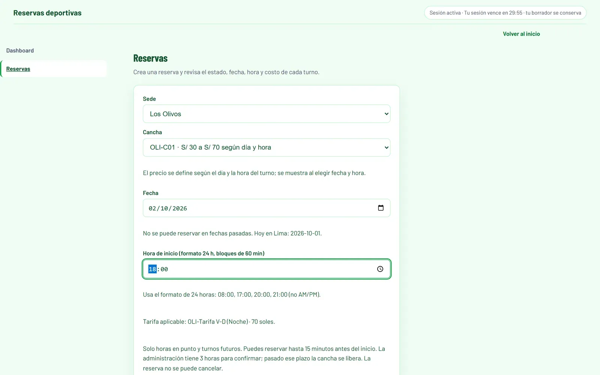

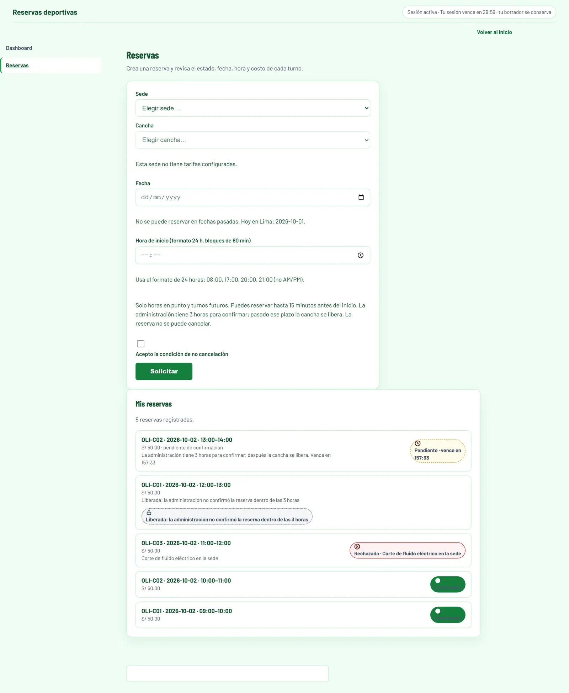

### Operación por sede

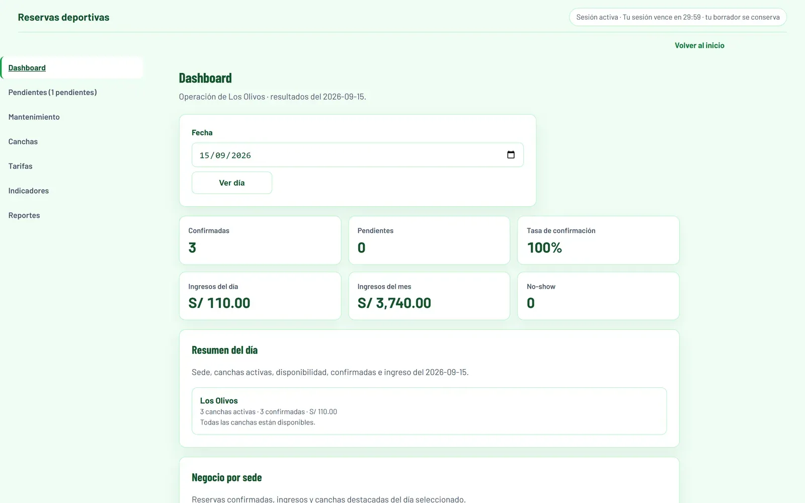

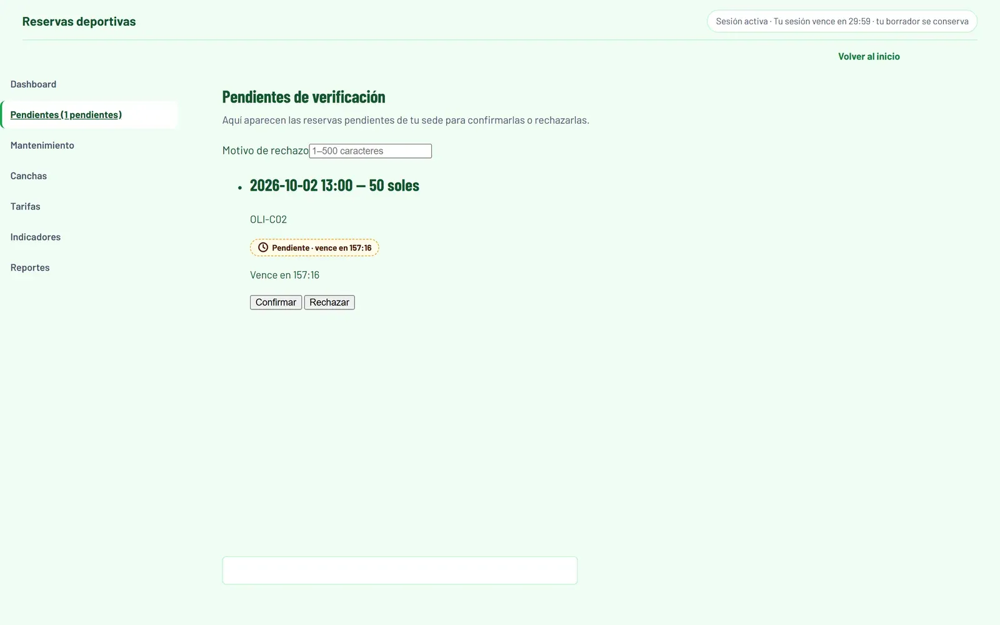

### Vista global y reportes

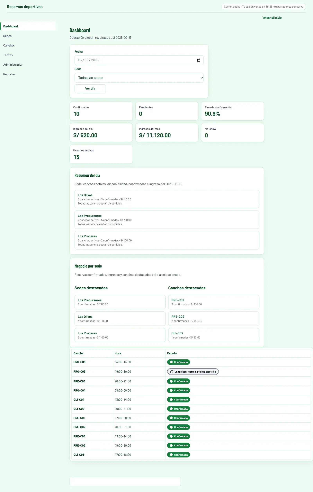

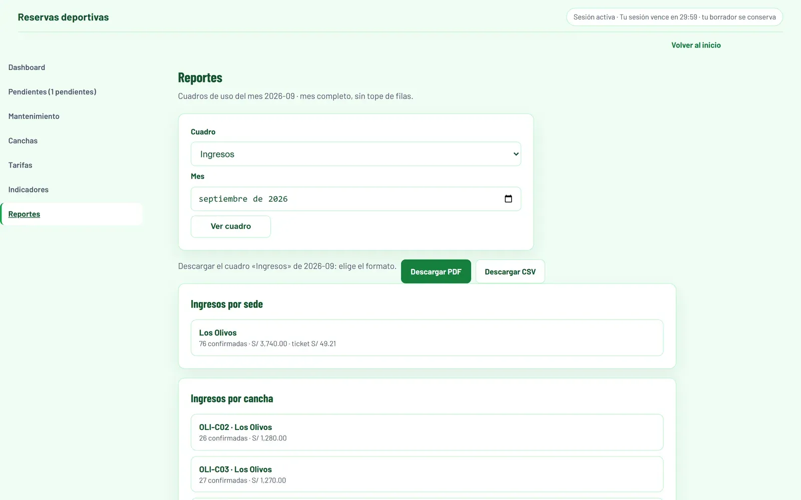

<details>
<summary>Otras vistas (portada, acceso, grilla diaria, catálogo, tarifas, sedes, indicadores)</summary>


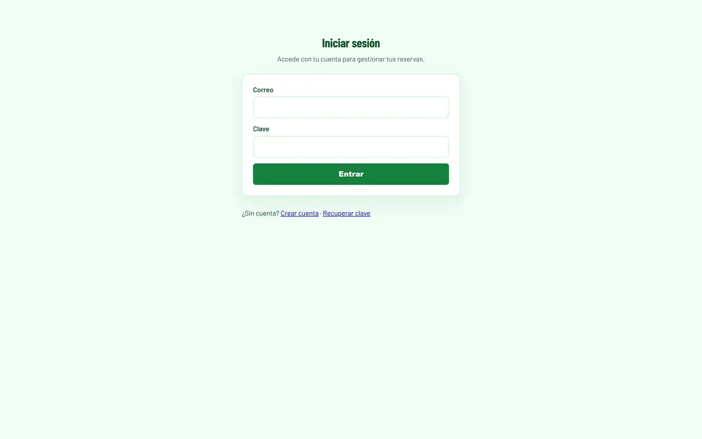
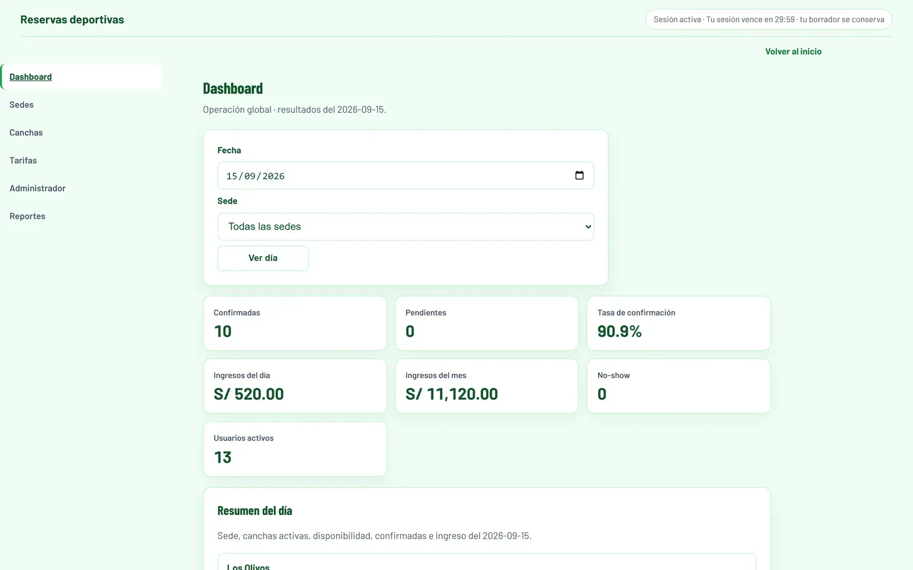
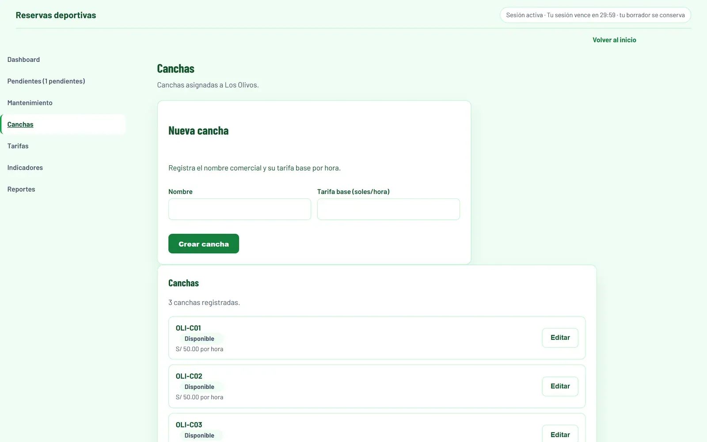
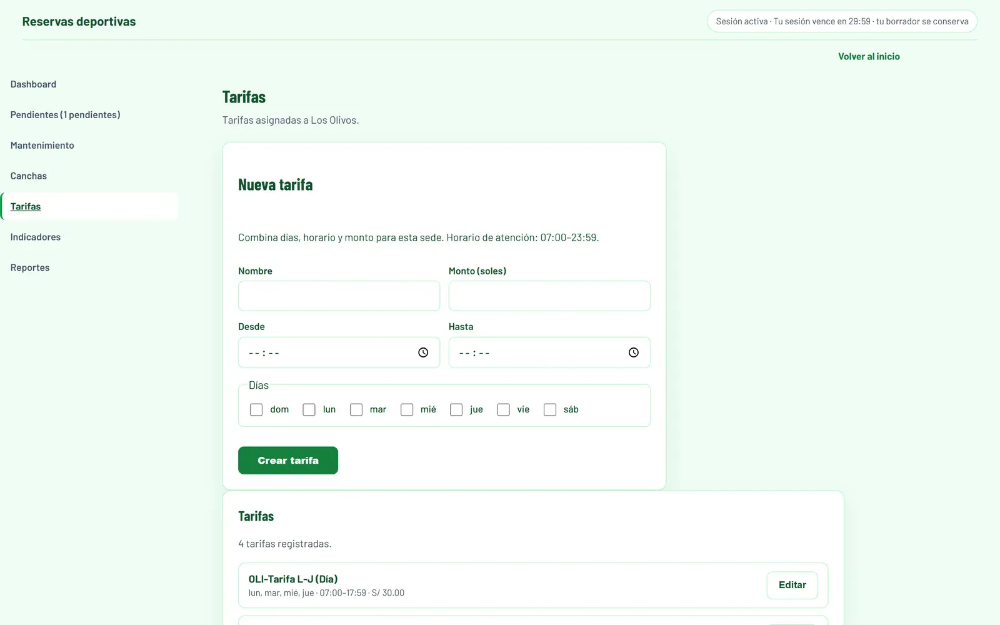
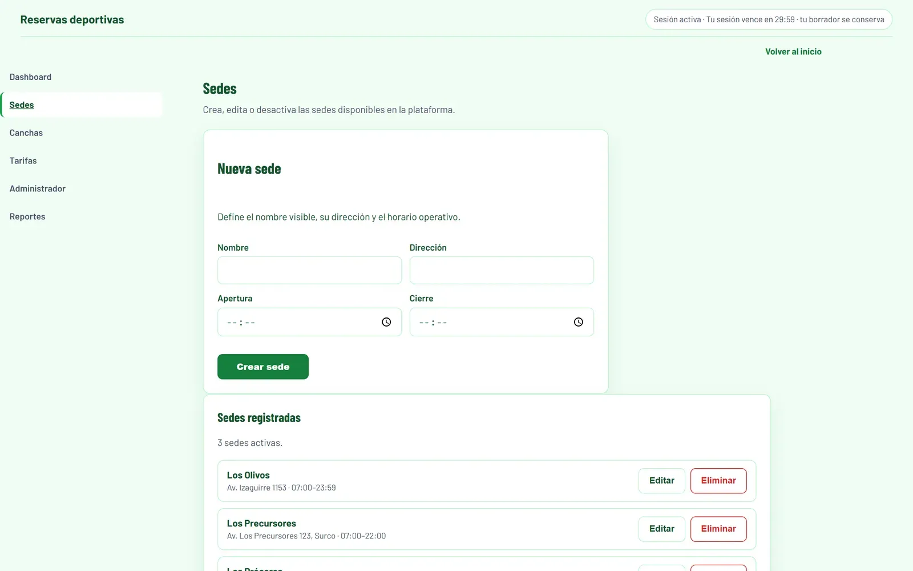
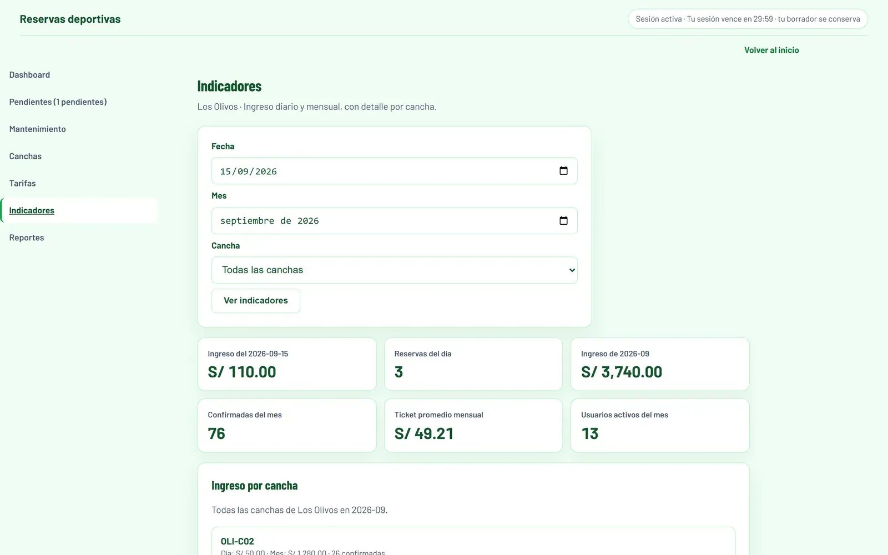
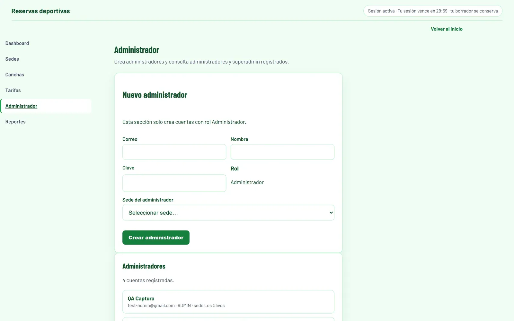
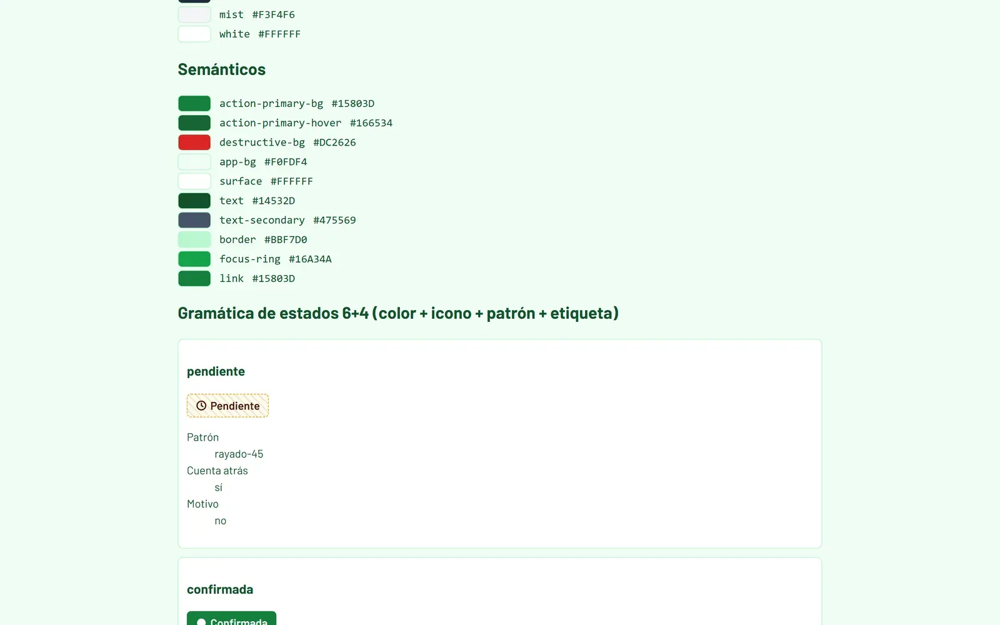
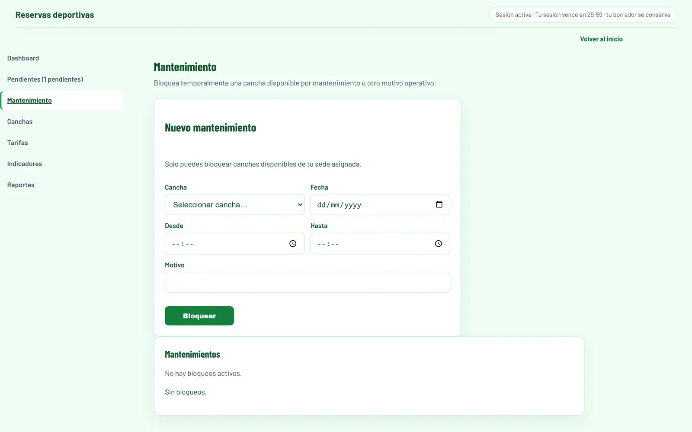

</details>

Las capturas ilustran los flujos del proyecto con datos ficticios de demostración. Cada imagen se amplía al hacer clic.

---

## Inicio rápido

Requisitos: Node.js >= 20 y una base PostgreSQL disponible.

```bash
npm ci
cp .env.example .env   # completar variables de entorno
npx prisma migrate deploy
npm run dev
```

Crear el primer `SUPERADMIN` (una sola vez, solo si aún no existe ninguno):

```bash
BOOTSTRAP_ADMIN_EMAIL=admin@ejemplo.com \
BOOTSTRAP_ADMIN_CLAVE=cambiar-esta-clave \
BOOTSTRAP_SEDE="Sede principal" \
node scripts/crear-superadmin.mjs
```

A partir de ese usuario se crean las cuentas `ADMIN` por sede. El registro público siempre crea rol `USUARIO`.

| Script | Descripción | Criterio esperado |
|---|---|---|
| `npm run dev` | Servidor de desarrollo | — |
| `npm run build` | Compilación de producción | Sin errores |
| `npm run typecheck` | `tsc --noEmit` | Sin errores |
| `npm run lint` | ESLint | Sin errores |
| `npm run test` | Vitest (unitarias e integración) | Ejecutar con una BD de pruebas aislada para las suites de integración |
| `npm run test:e2e` | Playwright contra build local en `:3100` | Requiere navegador y entorno de pruebas aislado |

### Variables de entorno

| Variable | Uso | Sin ella |
|---|---|---|
| `DATABASE_URL`, `DIRECT_URL` | Conexión a PostgreSQL | La aplicación no inicia |
| `JWT_SECRET` | Firma de sesión | La aplicación no inicia |
| `DB_POOL_MAX`, `DB_POOL_IDLE_MS`, `DB_POOL_CONEXION_MS` | Tamaño y tiempos del pool (valores por defecto: 10 conexiones, 30 s, 8 s) | Se usan los valores por defecto |
| `CRON_SECRET` | Expiración de reservas y purga programada | La liberación sigue funcionando por verificación oportunista, sin purga |
| `SUPABASE_URL`, `SUPABASE_SERVICE_ROLE_KEY`, `SUPABASE_STORAGE_BUCKET` | Almacenamiento de comprobantes | La subida responde `503` |
| `SMTP_HOST`, `SMTP_PORT`, `SMTP_SECURE`, `SMTP_USER`, `SMTP_PASS`, `SMTP_FROM` | Envío de correos | La recuperación genera el token pero no envía el correo |
| `FRONTEND_URL` | Enlace incluido en el correo de recuperación | El correo usa la URL por defecto |

Utilidades de diagnóstico:

```bash
node scripts/probar-correo.mjs destino@correo.com  # verifica SMTP
node scripts/verificar-storage.mjs --crear          # verifica bucket y subida/descarga
node scripts/diagnostico-pool.mjs                   # revisa pool y conexiones
```

---

## Calidad y pruebas

El proyecto combina pruebas de dominio y componentes con dobles, pruebas de integración sobre PostgreSQL y flujos de navegador. Las suites incluyen casos de concurrencia, control de acceso y consistencia de ingresos.

| Verificación | Alcance | Última revisión local (2026-11-07) |
|---|---|---|
| Vitest: subconjunto sin servicios externos | 47 archivos de dominio, API con dobles y componentes | 189 tests aprobados; no equivale a la suite completa |
| TypeScript y ESLint | Análisis estático | Aprobados en la revisión local; en la copia aislada, ESLint se limitó a app, lib y components |
| Build | Compilación con Next.js | Aprobado en una copia local de pruebas |
| Integración, seguridad con BD y Playwright | API/BD, permisos, concurrencia y flujos de navegador | Pendientes de nueva ejecución en un entorno aislado |
| Cobertura global | Umbrales definidos en Vitest | No verificada en esta revisión |

Notas:

- Las suites de integración y E2E crean y eliminan datos. Deben apuntar exclusivamente a una base desechable, con cuentas y credenciales propias de pruebas.
- Playwright usa un solo worker (ver `playwright.config.ts`); ejecutar en serie no sustituye el aislamiento de datos.
- Storage y SMTP requieren configuración específica para verificar sus integraciones; los dobles no acreditan el funcionamiento de los servicios externos.
- Los resultados descritos corresponden a la revisión local indicada y no certifican el estado de un despliegue ni de ejecuciones posteriores de CI.

---

## Decisiones de arquitectura

- **El servidor es la fuente de verdad.** El JWT solo transporta identidad; cada autorización se resuelve contra la fila actual del usuario en la base de datos.
- **Sin doble reserva por diseño.** Bloqueo pesimista sobre la cancha más índice único parcial en los estados que ocupan plaza.
- **Expiración independiente del cron.** El plazo de 3 horas se aplica por job programado (Vercel / GitHub Actions) y por verificación oportunista en lecturas y escrituras de reservas.
- **Sincronización idempotente.** Cada operación offline lleva un identificador único; el reintento no duplica efectos y cada respuesta indica si fue ejecutada, rechazada o quedó pendiente.
- **Errores clasificables sin filtrar internals.** Los fallos transitorios responden `503` con código `DB_NO_DISPONIBLE`; los mensajes de Prisma/`pg` nunca llegan al cliente.

Alcance del modelo: 31 rutas API, 13 tablas, 12 migraciones, 21 páginas.

---

## Preguntas frecuentes

**¿Por qué los turnos son solo en hora en punto?**
Porque el bloque es de 60 minutos. Un turno iniciado a las 20:20 terminaría a las 21:20 y no encajaría en la vista diaria ni en la disponibilidad del resto de canchas.

**¿Qué ocurre si administración no responde?**
A las 3 horas la reserva pasa a `LIBERADA` y la cancha vuelve a estar disponible. El usuario ve el motivo en su historial.

**¿Puede un administrador operar otras sedes?**
No. Cada sesión de administrador está asociada a una sede y la API valida esa correspondencia en cada operación. Solo el superadmin opera a nivel global.

**¿Cómo se garantiza el precio correcto?**
El importe se calcula en el servidor cruzando día de la semana y franja horaria con las tarifas vigentes, con el mismo cálculo que muestra el formulario. La tarifa base solo aplica si ninguna tarifa cubre ese horario.

**¿Por qué los reportes no reutilizan el endpoint de reservas?**
Porque `/api/solicitudes` está paginado (máximo 100 filas). Los reportes consultan con filtro por mes completo para que los totales no queden recortados.

---

## Limitaciones conocidas y próximos pasos

- **Notificaciones push:** los avisos se calculan en el servidor y se muestran en el centro de notificaciones; no hay Service Worker con push nativa.
- **Plan de mantenimiento de base de datos:** las migraciones se aplican manualmente con `prisma migrate deploy`; falta automatizar vacuum, respaldos y alertas.
- **Verificación externa:** la subida de comprobantes (Supabase) y el envío de correos (SMTP) requieren credenciales reales y se omiten en local sin ellas.

El alcance de la validación disponible se resume en [Calidad y pruebas](#calidad-y-pruebas).

---

## Autor y licencia

Desarrollado por **Lino Chamorro** — producto, reglas de negocio y despliegue.

Licencia MIT — ver [`LICENSE`](LICENSE).
