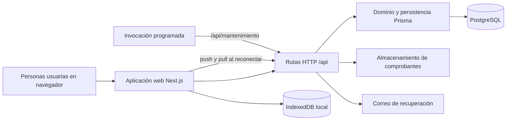

# SportComplex: visión general

SportComplex es una aplicación web para gestionar reservas de canchas en varias sedes. La interfaz y las rutas HTTP se ejecutan en Next.js App Router; la persistencia relacional usa PostgreSQL mediante Prisma. La aplicación incluye gestión de cuentas y permisos, disponibilidad y tarifas, solicitudes de reserva, operación de sede, reportes y sincronización de operaciones preparadas sin conexión.

## Contexto

La integración con correo y almacenamiento está encapsulada en adaptadores. Su disponibilidad depende de configuración del entorno; este documento no afirma que servicios externos estén activos. El endpoint de mantenimiento valida autorización Bearer antes de liberar reservas vencidas y purgar registros retenidos.

## Capacidades

- Consultar sedes, canchas, tarifas y disponibilidad.
- Crear y administrar solicitudes de reserva, bloqueos y comprobantes.
- Presentar paneles e informes de operación.
- Mantener una cola local de operaciones y reconciliar cambios con el servidor.

## Límites

Las reglas de negocio se implementan en rutas y módulos de dominio del servidor, con restricciones y transacciones de persistencia donde corresponde. La base de datos es la fuente persistente; IndexedDB permite cola y caché local, no sustituye la confirmación del servidor. La topología de despliegue depende de configuración externa y no se describe aquí como un entorno activo.

## Mapa documental

- [Estructura y límites](01-estructura.md)
- [Persistencia y sincronización](02-datos-y-sincronizacion.md)
- [Seguridad y acceso](03-seguridad-y-autenticacion.md)
- [HTTP y componentes](04-api-y-componentes.md)
- [Decisiones registradas](../decisions/index.md)
- [Invariantes de sincronización](../SYNC_INVARIANTES.md)
